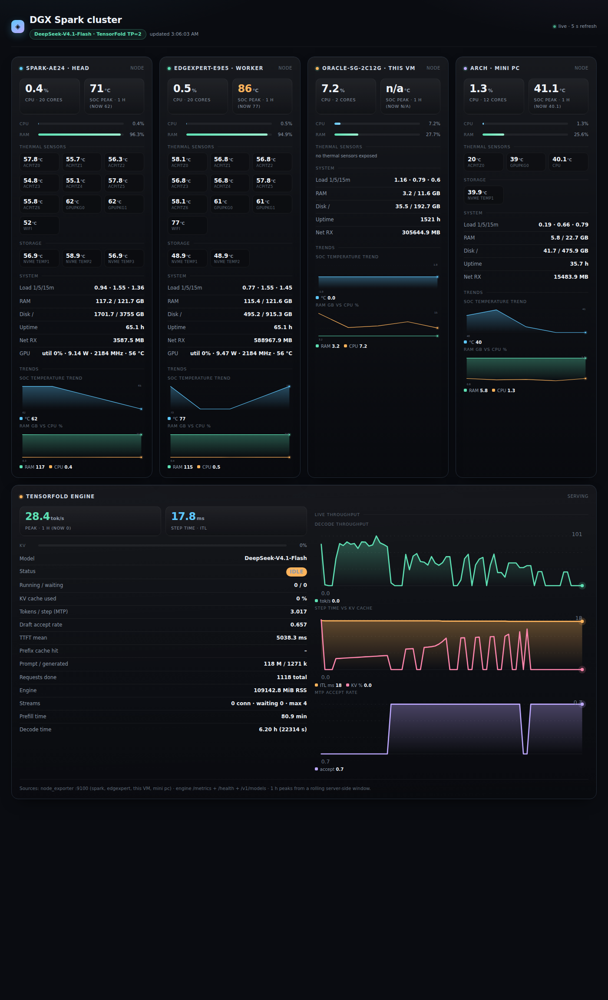

# clusterwatch — cluster status dashboard

Self-hosted status page for a small GPU cluster (DGX Spark nodes, an x86 worker, and
the monitoring VM itself). It renders host temperatures per sensor, CPU/RAM/disk/load,
1-hour rolling peaks, and the live serving metrics of the LLM engine (TensorFold or
vLLM), plus an optional ComfyUI probe.

Everything is scraped over plain HTTP from Prometheus `node_exporter` instances and the
engine's own `/metrics` — no SSH, no agent on the targets.

- Page: `http://<host>:8090/`
- JSON: `http://<host>:8090/data`
- History: `http://<host>:8090/hist?r=<seconds>`

**All hosts, engine endpoints, ports, thresholds and file paths come from
`config.yaml`.** Nothing host-specific is hardcoded in the code; edit the config and
restart the service.




## Quick start

```bash
git clone https://github.com/sebastian93921/clusterwatch.git /opt/clusterwatch
cd /opt/clusterwatch
$EDITOR config.yaml          # list your hosts + engine endpoints
sudo cp deploy/dgxdash.service /etc/systemd/system/
sudo systemctl daemon-reload && sudo systemctl enable --now dgxdash
curl -s localhost:8090/data | head -c 400
```

---

## 1. Requirements

On the machine that runs the dashboard:

- Python 3.10+ with `PyYAML` (`python3 -c "import yaml"` must succeed)
- Network reachability (e.g. Tailscale) to every monitored host's `node_exporter`

On every monitored host:

- `node_exporter` listening on `:9100` (`http://<host>:9100/metrics`)

Optional: an LLM engine exposing Prometheus metrics (`/metrics`), `/health` and
`/v1/models` (TensorFold, vLLM), and ComfyUI on `:8188` for the workflow queue panel.

Install PyYAML if missing (Debian/Ubuntu):

```bash
sudo apt install python3-yaml          # or: pip install --user pyyaml
```

---

## 2. Configure

Copy `config.yaml` and edit it. Every section is required only if you use that feature;
omitted sections fall back to the defaults baked into `dgxdash.py`.

### 2.1 `hosts` — the machines you want listed

Each entry becomes one card on the page, in list order. Only `key` and
`node_exporter` are mandatory.

```yaml
hosts:
  - key: spark                 # unique id, used in /data and history files
    label: spark-ae24 · head   # card heading
    role: gpu-primary          # free text, shown in /data
    node_exporter: http://192.168.1.11:9100/metrics
    accent: "#5ec8ff"          # card accent colour
    enabled: true              # false = keep the entry, hide the card
    gpu:
      ssh: gpu@192.168.1.11   # optional: nvidia-smi via SSH
      via: null                      # optional jump host for the SSH call
```

| Field | Required | Meaning |
|---|---|---|
| `key` | yes | Unique short id. Appears as `nodes[].key` and as a flat alias `data.<key>`. |
| `node_exporter` | yes | Full URL of the node_exporter metrics endpoint. |
| `label` | no | Card title; defaults to `key`. |
| `role` | no | Free-form role string, passed through to `/data`. |
| `accent` | no | Any CSS colour; drives the card's accent dot. |
| `enabled` | no | `false` removes the host from scraping and the page. |
| `gpu.ssh` | no | `user@host` for the optional `nvidia-smi` probe. |
| `gpu.via` | no | Jump host to reach `gpu.ssh` through (needed when the target only trusts another node's key). |

To add a machine: append an entry, restart the service, reload the page. To hide one:
set `enabled: false` (keeps history keys stable).

### 2.2 `llm_engine` — the serving stack

```yaml
llm_engine:
  enabled: true
  base_url: http://192.168.1.11:8888   # no trailing slash
  metrics_path: /metrics
  health_path: /health
  models_path: /v1/models
  model: null                 # null = auto-detect from /v1/models; or pin a name
  context_window_fallback: 500000
  scrape_interval_s: 0.8      # gap between the two counter snapshots
  timeout_s: 5
```

| Field | Default | Meaning |
|---|---|---|
| `enabled` | `true` | Master switch; `false` hides the engine card and skips scraping. |
| `base_url` | – | Engine root, e.g. `http://host:8888`. Empty = engine disabled. |
| `metrics_path` | `/metrics` | Prometheus metrics path. |
| `health_path` | `/health` | Health/JSON status path (used to detect TensorFold vs vLLM). |
| `models_path` | `/v1/models` | Model identity source. The page shows whatever this returns — never a hardcoded name. |
| `model` | `null` | Pin a display name; `null` keeps auto-detection. |
| `context_window_fallback` | `500000` | Context window used when the engine reports none (TensorFold exposes no `context_length`). `/health` wins when it does. |
| `scrape_interval_s` | `0.8` | Delay between the two counter snapshots used to derive tok/s; keep well under the page refresh interval. |
| `timeout_s` | `5` | Per-HTTP-request timeout. |

Throughput is computed from counter deltas (`generation_tokens_total` +
`generation_tokens_running` over the measured interval), not from `/health` averages —
so an idle engine shows `0`, never a stale smoothed value.

### 2.3 `comfyui` — optional diffusion queue probe

```yaml
comfyui:
  enabled: true
  base_url: http://192.168.1.11:8188
  system_stats_path: /system_stats
  queue_path: /queue
  cache_seconds: 30
```

Set `enabled: false` (or leave `base_url` empty) if you don't run ComfyUI; the page
then shows `offline` without waiting on a connection.

### 2.4 `history` — persisted samples

```yaml
history:
  peaks_window_s: 3600              # rolling window for the "1 h peak" KPIs
  short_samples: 72                 # samples kept for the engine trend charts
  short_path: /opt/clusterwatch/dash_hist.json
  long_interval_s: 60               # background cluster sampler period
  long_retention_minutes: 10080     # 7 days of minute resolution
  long_path: /opt/clusterwatch/temp_long.json
```

History lives server-side on disk so charts survive page reloads and service
restarts. Both files are written atomically (`tmp` + `os.replace`).

### 2.5 `thresholds` — chip colouring

```yaml
thresholds:
  soc_hot_c: 85     # amber from this temperature
  soc_crit_c: 95    # red from this temperature
  nvme_hot_c: 70
  nvme_crit_c: 80
```

These are fallbacks only: when a host's `node_exporter` publishes real
`node_hwmon_temp_crit_celsius` values, the driver-reported crit overrides them.

### 2.6 `server`

```yaml
server:
  bind: 0.0.0.0
  port: 8090
  refresh_seconds: 5
  page_title: DGX Spark cluster · TP=2
```

### 2.7 `ssh` — optional GPU probe

Only used when a host sets `gpu.ssh`. Everything else is HTTP-only; no
credentials are stored anywhere.

```yaml
ssh:
  key: "~/.ssh/id_ed25519"   # path to the private key (~ expands)
  gpu_cache_s: 60            # nvidia-smi over SSH is slow; cache the result
```

The dashboard must run as the user that owns this key. If it runs as root,
`~` resolves to `/root` and the probe fails with a warning in the journal
(`[gpu] nvidia-smi probe failed for …`) instead of failing silently.

---

## 3. Run

Foreground (test):

```bash
python3 /opt/clusterwatch/dgxdash.py
# or with an alternate config:
DGXDASH_CONFIG=/path/to/other.yaml python3 /opt/clusterwatch/dgxdash.py
```

As a service (`/etc/systemd/system/dgxdash.service`):

```ini
[Unit]
Description=DGX Spark cluster status dashboard
After=network-online.target

[Service]
Type=simple
User=ubuntu
Group=ubuntu
WorkingDirectory=/opt/clusterwatch
ExecStart=/usr/bin/python3 /opt/clusterwatch/dgxdash.py
Restart=always
RestartSec=2

[Install]
WantedBy=multi-user.target
```

```bash
sudo systemctl daemon-reload
sudo systemctl enable --now dgxdash
sudo systemctl restart dgxdash        # after any config.yaml edit
systemctl is-active dgxdash
```

The service logs one line at startup with the loaded config path, active host keys and
engine URL — check `journalctl -u dgxdash -n 20` if a host is missing.

---

## 4. Endpoints

| Path | Returns |
|---|---|
| `/` | HTML dashboard (single page, SVG trends, 5 s refresh by default) |
| `/data` | Aggregated JSON: `nodes[]` (per-host metrics, sensors, crit, peaks, optional `gpu`), `engine` (model, tok/s, KV, MTP, TTFT, prefill/decode totals), `comfy`, `ts` |
| `/hist?r=<seconds>` | Decimated, max-aggregated history (peaks preserved); `r` defaults to 86400 |

`/data` also keeps a flat alias per host (`data.spark`, `data.edge`, …) for cron jobs
and older clients, alongside the canonical `nodes[]` array.

Adding a host to `config.yaml` automatically adds it to `/data`, the page and the
history series — no code change.

---

## 5. Troubleshooting

| Symptom | Cause / fix |
|---|---|
| `[config] cannot read …` at startup | Wrong path or unreadable file; check `DGXDASH_CONFIG` and permissions. |
| Page shows no cards | `hosts:` empty or every entry has `enabled: false`. |
| A card shows `n/a` temperatures | `node_exporter` reachable but the host exposes no thermal zones; check `curl http://host:9100/metrics \| grep thermal_zone`. |
| Engine card says `disabled` | `llm_engine.enabled: false` or empty `base_url`. |
| Model shows `N/A` | `/v1/models` unreachable or returned no id; the model name is never hardcoded. |
| `Address already in use` | Another instance (or the service) already owns the port; change `server.port` or stop the other process. |
| GPU row missing on a node | `gpu.ssh` set but the probe failed; check `ssh.key`, that the service runs as the key's owner (`User=`), and `journalctl -u dgxdash` for `[gpu] nvidia-smi probe failed`. |
| `ModuleNotFoundError: yaml` | `sudo apt install python3-yaml`. |
